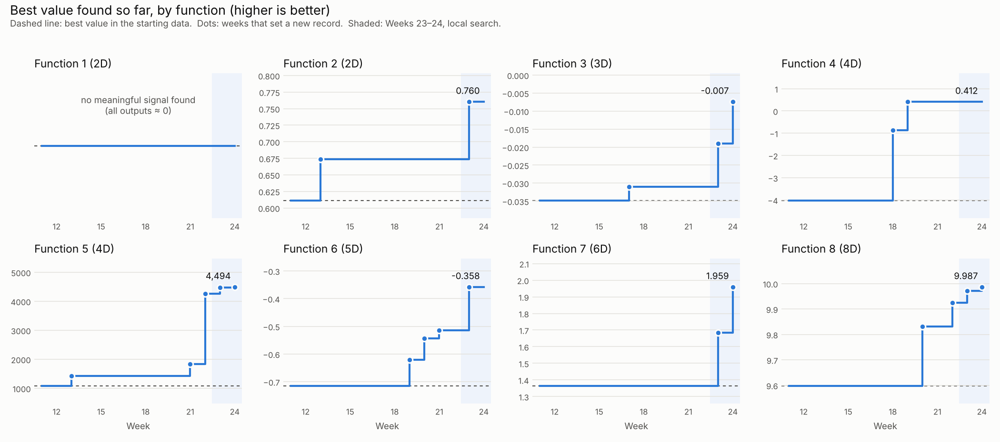
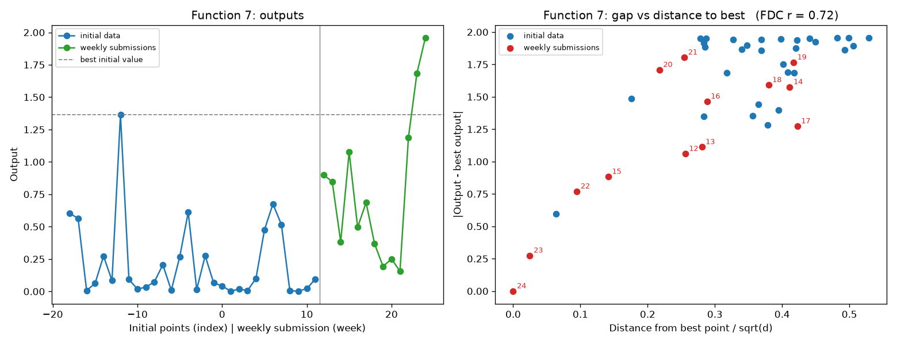

# Black-Box Optimisation (BBO) Capstone

**Author:** Chakkapas Visavakul. Final capstone project for the Professional Certificate in Machine Learning and Artificial Intelligence, Imperial College Business School (2026).

## Non-technical explanation

Imagine searching for the highest point of eight hidden landscapes while blindfolded, allowed only one step per landscape each week. That was this project. Each landscape is an unknown mathematical function: a system whose settings I could change but whose inner workings I could not see. Over 13 weeks I chose one new setting per function, observed the result, and used a statistical model called a Gaussian Process to decide where to try next. I explored unfamiliar areas first, then searched closely around the best results. Seven of the eight functions finished above the best value I started with, most of them during the last two weeks.

## Data

The data comes from the capstone's BBO challenge, run through the course's capstone project portal. There are eight unknown functions with 2 to 8 inputs. Every input lies between 0 and 1, and each function returns a single number to **maximise**.

| Function | Inputs | Starting points | Weekly queries | Total points |
|:--:|:--:|:--:|:--:|:--:|
| 1 | 2 | 10 | 13 | 23 |
| 2 | 2 | 10 | 13 | 23 |
| 3 | 3 | 15 | 13 | 28 |
| 4 | 4 | 30 | 13 | 43 |
| 5 | 4 | 20 | 13 | 33 |
| 6 | 5 | 20 | 13 | 33 |
| 7 | 6 | 30 | 13 | 43 |
| 8 | 8 | 40 | 13 | 53 |

- `data/function_N/initial_inputs.npy` and `initial_outputs.npy` contain the starting points supplied by the course.
- `data/inputs.txt` and `data/outputs.txt` contain my 13 weekly queries (Weeks 12–24) and the values the portal returned, one line per week.
- `data/funcN-data.csv` combines both sources into one table per function, generated by `src/dataset_csv.py`.

The full description, including known noise and biases, is in the [datasheet](docs/DATASHEET.md).

## Model

All of my methods use a **Gaussian Process (GP)** surrogate model. A GP predicts the output at untested points and estimates how uncertain each prediction is. An *acquisition function* then turns these two numbers into a choice of where to query next, balancing exploration (trying uncertain areas) against exploitation (refining near the best result).

I chose a GP because each query cost one week, so I had very little data: 10–40 points per function at the start. GPs work well with small datasets and give the uncertainty estimates that Bayesian optimisation needs. My method changed as I learned more about the functions:

| Weeks | Method | Script |
|:--|:--|:--|
| 12 | Experiments: GP with Expected Improvement (EI) on a grid or via SciPy for Functions 1–3; "largest empty space" search for Functions 4–8 | `func-argmax.py`, `func-scipymin.py`, `func-isolated.py`, `func-dirichlet.py` |
| 13–19 | `scikit-optimize` GP: EI for Functions 1–3; Lower Confidence Bound (LCB) for Functions 4–8 | `func-skopt.py` |
| 20–22 | TuRBO trust-region BO (BoTorch tutorial) for Functions 4–8; HEBO for Functions 4–6 in Week 22 | `func-turbo.py`, `func-hebo.py` |
| 23–24 | My own local GP search: a fixed-size box around the best point, with no PyTorch dependency | `func-local.py` |

The final local search fits a scikit-learn GP (Matérn 5/2 kernel with one length scale per input, plus a noise term) to **all** the data. It then searches only inside a box of fixed width around the best point. I wrote it because TuRBO resizes its own search region and HEBO ignores data outside its bounds, while I wanted to set the region myself and still use every point.

More detail, including limitations, is in the [model card](docs/MODELCARD.md).

## Hyperparameter optimisation

The hyperparameters controlled how far each method explored. With one query per function per week, a formal tuning loop wasn't possible, so I set them by hand following an explore-then-exploit schedule. Every week's settings are recorded in [`src/week-run-params.csv`](src/week-run-params.csv).

| Hyperparameter | Values used | How I chose them |
|:--|:--|:--|
| EI `xi` (Functions 1–3) | 0.02–0.05 → 0.02 → 0.01 | Started exploratory, lowered in Week 22 |
| LCB `kappa` (Functions 4–8) | 4.0 (Weeks 13–17) → 2.0 (Weeks 18–19) | Lowered when the exploration phase had produced few new records |
| GP acquisition restarts | 30–130, more for higher dimensions | More restarts so the acquisition optimiser finds a better maximum in larger spaces |
| TuRBO `failure_tolerance` | 3 for Functions 4–5, 2 for Functions 6–8 | Controls how quickly the trust region shrinks after misses |
| Local search `radius` | 0.05–0.10 (Week 23) → 0.03–0.05 (Week 24) | Chosen from distance-versus-output plots (`plot-fdc.py`, `trace-margin.py`) |
| Local search `beta` | 0.5 (Week 23) → 0.0 (Week 24) | Removed the exploration bonus for the final query |
| Search centre | best observed point, or the GP's best predicted point for Functions 2 and 3 | Functions 2 and 3 proved noisy, so a single high reading could be luck |
| Output transform | log(y) for Function 5 | Its outputs span thousands, so a log scale is easier to model |

The GP's own kernel hyperparameters (length scales, signal variance, noise level) are fitted automatically each run by maximising the marginal likelihood.

## Results

Performance is measured as the **best output found**, compared with the best value in the starting data. Each function is reported separately because their scales differ widely.



| Function | Best in starting data | My best | Week found | Method |
|:--:|--:|--:|:--:|:--|
| 1 | 7.7 × 10⁻¹⁶ | 7.7 × 10⁻¹⁶ | – | No improvement; outputs were essentially zero |
| 2 | 0.611 | **0.760** | 23 | Local search |
| 3 | −0.0348 | **−0.0074** | 24 | Local search |
| 4 | −4.026 | **0.412** | 19 | `scikit-optimize` LCB, kappa = 2.0 |
| 5 | 1,088.9 | **4,494.0** | 24 | HEBO (to 4,267 in Week 22), then local search |
| 6 | −0.714 | **−0.358** | 23 | Local search |
| 7 | 1.365 | **1.959** | 24 | Local search |
| 8 | 9.598 | **9.987** | 24 | Local search |

**What I learned:**

- **Local search worked best late on.** The 16 local-search queries in Weeks 23–24 set 10 of my 22 new records. The 48 exploration queries in Weeks 12–17 set only 3.
- **I explored for too long.** High `kappa` values gathered information but rarely improved results. Peers who switched to a trust region earlier had more weeks to benefit from it.
- **Some functions are noisy.** Because a script error, Week 21 resubmitted Week 20's inputs. Function 2 returned 0.569, then 0.611 for identical inputs, and Function 3 behaved similarly. Small gains on these functions may be partly noise.
- **Simple ideas can beat the optimiser.** My best Function 5 point has three inputs at their maximum (1.0). Peers reached about 8,662 by setting all four inputs to 1.0, a simple test my local search was approaching too slowly.
- **Understand the data before choosing the method.** Every optimiser makes assumptions. A GP assumes a smooth function, which Function 1's near-zero outputs violate.

The plots in `output/` show, for each function, how far each point is from the best one against how much worse its output is (the fitness-distance correlation). This helped me choose the local search radius:



## How to run the code

Tested with Python 3.13 on Linux. All scripts read their paths from `src/class_config.py` and must be run from the `src` folder.

```bash
git clone <this repository>
cd <repository>/src
pip install --no-deps --no-build-isolation hebo
pip install gpytorch pymoo disjoint_set numpy pandas
pip install scikit-optimize

# Suggest the next point for Function 5 using all data up to Week 24
# (radius 0.05, no exploration bonus, start from the best observed point, log scale)
python3 func-local.py 25 5 0.05 0 best_obs log

# Show (without running) the methods and settings used in Week 24
python3 run-week.py 24 --dry-run

# Re-run every function for Week 24; prints one "To-submit" line per function
python3 run-week.py 24

# Rebuild the per-function CSV files, then save the fitness-distance plot for Function 7
python3 dataset_csv.py --run
python3 plot-fdc.py 24 7 --save
```

The week number tells each script which data to use: running week *N* uses the starting data plus results from Weeks 12 to *N* − 1. Every script prints its usage when run without arguments. The scripts use fixed random seeds, so they give the same suggestion each time. During the challenge TuRBO's seed wasn't fixed, so re-running Weeks 20–22 may not reproduce exactly what I submitted; the current code fixes this. HEBO's results may also depend on library versions.

## Repository structure

```text
├── README.md                 # This file
├── LICENSE                   # MIT licence
├── docs/
│   ├── DATASHEET.md          # Dataset description, collection process and known issues
│   └── MODELCARD.md          # Model description, performance, limitations and trade-offs
├── data/
│   ├── function_1 … function_8/  # Starting data supplied by the course (.npy)
│   ├── inputs.txt, outputs.txt   # Weekly queries and returned outputs, Weeks 12–24
│   └── func1-data.csv …          # Combined data, one table per function
├── output/                   # Plots: best-so-far summary and fitness-distance plots
└── src/
    ├── class_config.py       # Paths and the first submission week
    ├── extra_points.py       # Loads starting data plus weekly results up to a given week
    ├── week-run-params.csv   # Method and settings used for every week and function
    ├── run-week.py           # Runs all eight functions for one week
    ├── func-generic.py       # Runs one function for one week from week-run-params.csv
    ├── func-*.py             # Command-line entry point for each method
    ├── optimizer_*.py        # Optimiser code: skopt, TuRBO, HEBO and local search
    ├── dataset_csv.py        # Builds data/funcN-data.csv
    ├── plot-fdc.py           # Fitness-distance plots
    └── trace-margin.py       # Distances and output gaps from the best point
```

## References

- HEBO, Huawei Noah's Ark Lab: https://github.com/huawei-noah/HEBO
- TuRBO tutorial, BoTorch: https://botorch.org/docs/v0.17.1/tutorials/turbo_1
- Eriksson, D. et al. (2019) *Scalable Global Optimization via Local Bayesian Optimization*. NeurIPS.
- Jones, T. and Forrest, S. (1995) *Fitness Distance Correlation as a Measure of Problem Difficulty for Genetic Algorithms*. ICGA.
- scikit-optimize: https://scikit-optimize.github.io

## Licence

The code in this repository is released under the [MIT Licence](LICENSE). The starting data for the eight functions was supplied by Imperial College Business School for the course and is included for educational purposes only; see the [datasheet](docs/DATASHEET.md#distribution).

## Contact

Chakkapas Visavakul. Please use GitHub issues on this repository.
