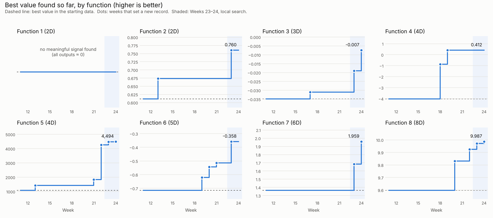

# Model Card: Staged Gaussian-Process Bayesian Optimisation for the BBO Capstone

**Author:** Chakkapas Visavakul · **Version:** final (after Week 24) · **Code:** `src/`

## Model Description

**Input:** For each of the eight functions, the model takes every evaluation collected so far: the input vectors (2–8 values, each in [0, 1]) and their outputs. That means the course's starting data plus my weekly results up to the week before the one being planned. It also takes the method and settings for that week and function from `src/week-run-params.csv`.

**Output:** One suggested input vector per function, clipped to [0, 1] and printed with six decimal places in the portal's format (for example `To-submit-w25-f5: 0.390042-0.999999-0.999999-0.999999`). The local search also prints the GP's predicted value at the suggested point, so the prediction can be compared with the actual result.

**Model Architecture:** This is not a single model. It is a Bayesian optimisation approach that changed in four stages. Each stage pairs a Gaussian Process (GP) surrogate, which predicts the output and its uncertainty, with an acquisition rule that chooses the next query.

| Stage | Weeks | Surrogate | Acquisition / search | Library |
|:--|:--|:--|:--|:--|
| 1. Experiments | 12 | GP (Functions 1–3); none (Functions 4–8) | EI on a grid or via SciPy; Functions 4–8: the point furthest from existing data (nearest neighbours, Dirichlet sampling) | scikit-learn, SciPy |
| 2. Global GP | 13–19 | GP with Matérn kernel and Gaussian noise | EI (`xi`) for Functions 1–3; LCB (`kappa`) for Functions 4–8; L-BFGS-B with 30–130 restarts | scikit-optimize |
| 3. Trust region / HEBO | 20–22 | GP with Matérn 5/2 kernel and one length scale per input (GPyTorch); HEBO's own surrogate | TuRBO: Thompson sampling inside a trust region that adapts to successes and failures; HEBO's default acquisition | BoTorch tutorial code, HEBO |
| 4. Local search | 23–24 | GP: constant × Matérn 5/2 kernel with one length scale per input, plus a white-noise term; 10 optimiser restarts; standardised outputs (log for Function 5) | Score mean + `beta` × standard deviation inside a fixed box of half-width `radius` around a centre point; 2¹⁵ Sobol candidates, plus the box edges along each axis, refined with L-BFGS-B; points within 0.001 of existing data are rejected | scikit-learn, SciPy (`src/optimizer_local.py`) |

The final local search was written for this project. TuRBO resizes its trust region automatically and HEBO only uses data inside the bounds it is given. My version lets me fix the box size myself while the GP is still trained on **all** the data. For the noisy Functions 2 and 3, the box is centred on the point the GP predicts is best rather than the highest observed value, which could just be a lucky noisy reading.

## Performance

**How performance is measured:** the best output found for each function, compared with the best output in the course's starting data. This is the only quantity the challenge rewards. Each function is reported separately because their scales range from about 10⁻¹⁶ to thousands. I didn't keep a log of predicted against actual values, so I can't report how well calibrated the model's uncertainty was.

**Data analysed:** all 279 evaluations: 175 starting points and 104 weekly queries from Weeks 12–24.

| Function | Inputs | Best in starting data | Final best | Week | Stage that found it |
|:--:|:--:|--:|--:|:--:|:--|
| 1 | 2 | 7.7 × 10⁻¹⁶ | 7.7 × 10⁻¹⁶ | – | none |
| 2 | 2 | 0.611 | 0.760 | 23 | Local search |
| 3 | 3 | −0.0348 | −0.0074 | 24 | Local search |
| 4 | 4 | −4.026 | 0.412 | 19 | Global GP (LCB, kappa = 2.0) |
| 5 | 4 | 1,088.9 | 4,494.0 | 24 | HEBO (to 4,267) then local search |
| 6 | 5 | −0.714 | −0.358 | 23 | Local search |
| 7 | 6 | 1.365 | 1.959 | 24 | Local search |
| 8 | 8 | 9.598 | 9.987 | 24 | Local search |

**New records set by each stage:**

| Stage | Weeks | Queries | New records | Records per query |
|:--|:--|:--:|:--:|:--:|
| Experiments and exploratory global GP (kappa 4.0) | 12–17 | 48 | 3 | 0.06 |
| Global GP, less exploration (kappa 2.0) | 18–19 | 16 | 3 | 0.19 |
| TuRBO / HEBO | 20–22 | 24 | 6 | 0.25 |
| Local search | 23–24 | 16 | 10 | 0.63 |

Seven of the eight functions improved on their starting best. For comparison, other participants reported about 8,662 on Function 5 (with all four inputs at 1.0) and solved Function 1 (about 2.0). These results show where my approach fell short, as described below.

## Limitations

- **Assumes a smooth function.** A GP with a stationary kernel assumes the function changes similarly everywhere. Function 1 is almost zero everywhere except a narrow peak, so the GP saw no signal and the model never found a meaningful value. Peers solved it by fitting a peak model to log-transformed outputs.
- **Noise is assumed, not measured.** The GP includes a noise term, but I only discovered that Functions 2 and 3 are noisy through an accidental duplicate submission in Week 21. Small improvements on these functions may be partly noise.
- **The local search can't escape its box.** With a radius of 0.03–0.10 it can only climb slowly, and it can't find a better optimum elsewhere. On Function 5 it was moving towards the corner (1, 1, 1, 1) by about 0.05 per week, too slowly to get there before the challenge ended.
- **Settings were chosen by hand.** The values of `xi`, `kappa`, `radius` and `beta` came from judgement and plots, not systematic tuning, so they may not suit other problems.
- **Thin data in high dimensions.** Function 8 has 53 points in 8 dimensions, so the GP is only reliable near points that have been sampled.
- **Not fully reproducible.** The scikit-optimize and local-search scripts use fixed seeds and give the same suggestion each time. TuRBO's seed wasn't fixed during Weeks 20–22, so those submissions can't be reproduced exactly; the current code fixes this. HEBO's suggestions also depend on library versions.
- **No uncertainty calibration check.** Predictions weren't logged against actual results before each submission, so overconfident predictions couldn't be spotted.

## Trade-offs

- **Exploration against exploitation.** High `kappa` and `xi` values mapped more of each function but produced few new records: 3 in 48 queries. Pure local search produced the most records (10 in 16 queries) but risks settling on a local optimum. My switch to exploitation came late: Week 23 of 24.
- **Fixed box against adaptive trust region.** A fixed radius is predictable and safe when few queries remain, but it doesn't widen after success like TuRBO, so it climbs slowly on smooth slopes such as Function 5.
- **Best observed against best predicted centre.** Centring on the GP's best prediction protects against noisy outliers on Functions 2 and 3. On noise-free functions it could centre the search away from a real peak, so I used it only where noise had been seen.
- **Library features against maintenance effort.** HEBO and TuRBO offered more advanced methods, but installing their original versions cost several weeks. The final local search uses only scikit-learn and SciPy, so it is easier to install and maintain, but has fewer features.
- **Where performance is weakest:** functions with sharp, narrow peaks (Function 1), noisy outputs (Functions 2 and 3), and optima on the boundary (Function 5), where a cautious local search moves too slowly.
